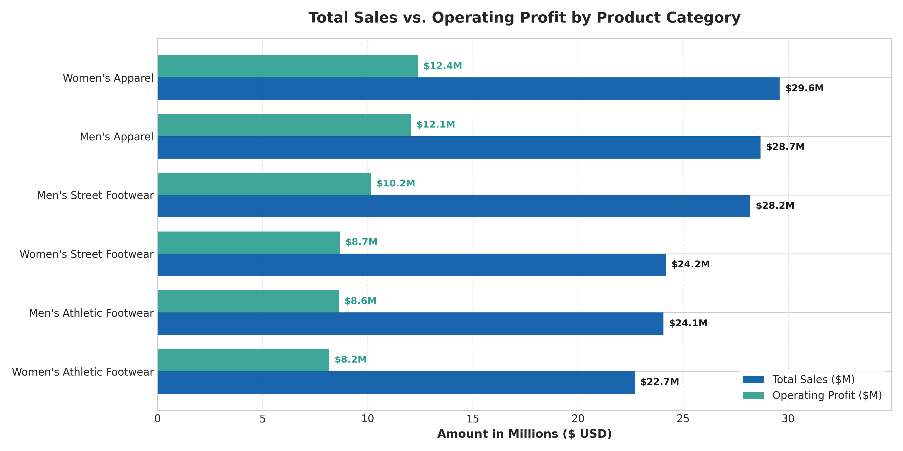
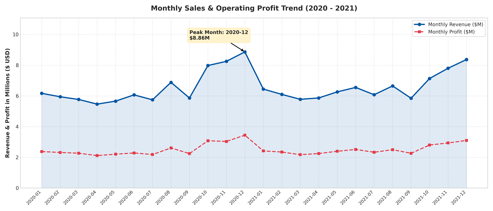
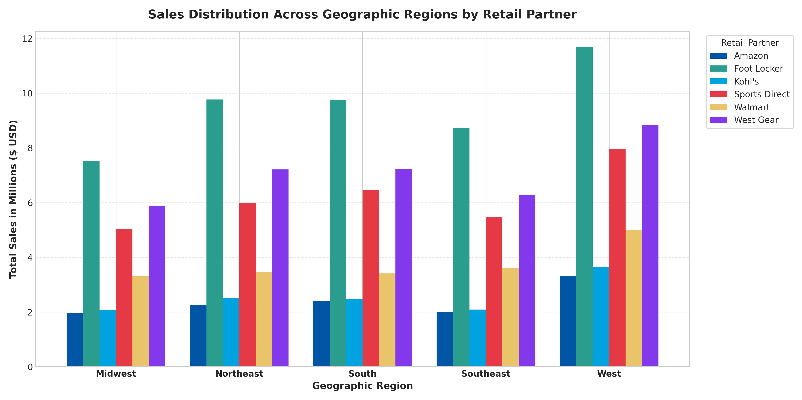
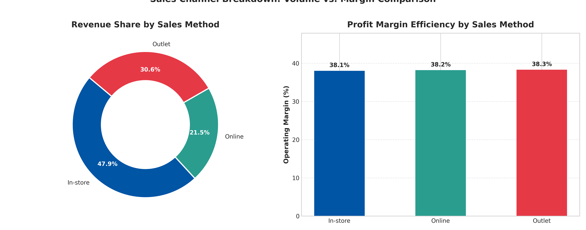
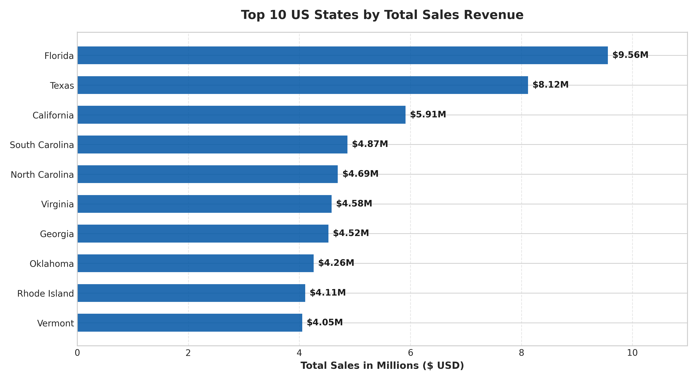
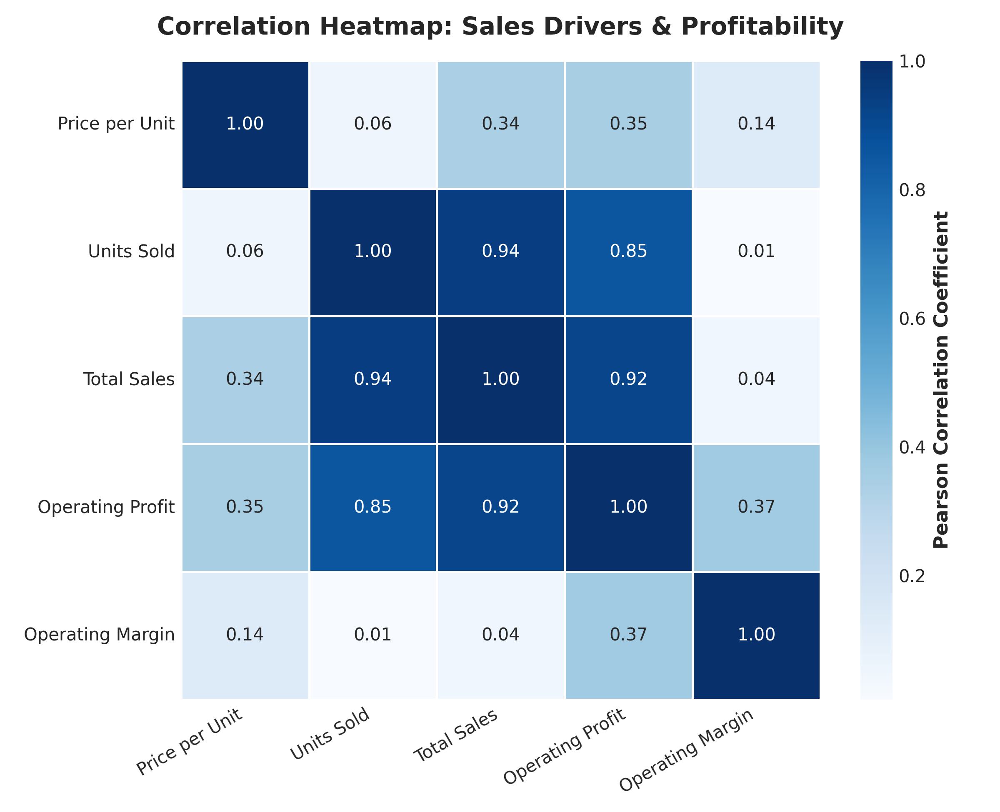
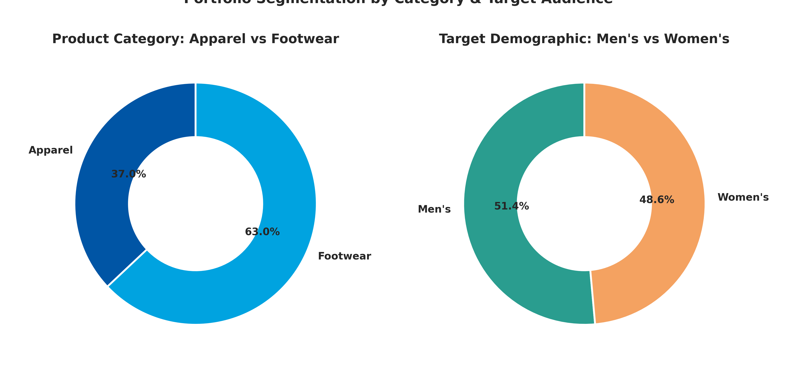

# 👟 Adidas US Sales Performance & Profitability Analytics

[](https://www.python.org/)
[](https://pandas.pydata.org/)
[](https://numpy.org/)
[](https://matplotlib.org/)
[](https://seaborn.pydata.org/)
[](https://jupyter.org/)
[](#)
[](#)

An end-to-end, production-grade Data Analytics project analyzing **Adidas US Sales, Profit Margins, Retail Distribution, and Channel Efficiencies** across 9,600+ transactions.

---

## 📑 Table of Contents (Vishy-Suchi)
1. [Executive Summary](#-executive-summary)
2. [Business Problem & Objectives](#-business-problem--objectives)
3. [Dataset Architecture & Dictionary](#-dataset-architecture--dictionary)
4. [Project Directory Structure](#-project-directory-structure)
5. [Data Cleaning & Engineering Pipeline](#-data-cleaning--engineering-pipeline)
6. [Key Visualizations & Business Insights](#-key-visualizations--business-insights)
7. [Strategic Recommendations](#-strategic-recommendations)
8. [Project Explanation in Simple Hinglish (Interview Preparation)](#-project-explanation-in-simple-hinglish-interview-preparation)
9. [How to Run Locally](#-how-to-run-locally)
10. [Author & Contact](#-author--contact)

---

## 📊 Executive Summary

This project conducts an in-depth exploratory data analysis of Adidas sales performance in the United States over a two-year timeframe (2020–2021). The primary objective is to uncover key revenue drivers, assess operating profit margins across product lines and sales methods, evaluate retail partner efficacy, and formulate actionable data-backed business strategies.

### Top-Line Key Performance Indicators (KPIs)
| Metric | Value | Business Significance |
| :--- | :--- | :--- |
| **Total Gross Revenue** | **$157,422,617.05** | Total sales volume across all channels |
| **Total Operating Profit** | **$60,094,993.56** | Net profit after direct operating expenses |
| **Overall Operating Margin** | **38.17%** | Healthy operational margin across retail and DTC |
| **Total Units Sold** | **2,857,166 pairs/units** | Aggregate footwear & apparel volume |
| **Average Unit Price** | **$54.79** | Weighted average retail transaction price |
| **Total Invoices Analyzed** | **9,648** | Full dataset coverage across 50 US states |

---

## 🎯 Business Problem & Objectives

Adidas operates through multiple retail channels (Foot Locker, Walmart, Sports Direct, West Gear, Kohl's, Amazon) and diverse distribution methods (In-store, Outlet, Online). Corporate leadership needs clear answers to critical commercial questions:

1. **Product Mix Optimization**: Which product categories generate top revenue vs. the highest profit margins?
2. **Sales Channel Efficiency**: Is the expansion into Direct-to-Consumer (Online) delivering superior margins compared to brick-and-mortar In-store and Outlet channels?
3. **Retail Partner Performance**: Which retail partners contribute the highest sales, and where is volume concentrated?
4. **Geographic Strongholds**: Which US regions and states represent high-yield markets?
5. **Seasonality & Timing**: What are the peak seasonal cycles (e.g., Q4 holidays), and how can inventory planning be improved?

---

## 🗂 Dataset Architecture & Dictionary

The dataset is modeled on the authentic benchmark Adidas US Sales schema consisting of **9,648 records** and **13 primary attributes**.

| Field Name | Raw Format | Cleaned Type | Description |
| :--- | :--- | :--- | :--- |
| `Retailer` | `str` | `Categorical` | Retail partner name (Foot Locker, Walmart, etc.) |
| `Retailer ID` | `int` | `int` | Unique numerical identifier for the retail account |
| `Invoice Date` | `YYYY-MM-DD` | `datetime64[ns]` | Transaction date |
| `Region` | `str` | `Categorical` | Geographic region (West, Northeast, Southeast, South, Midwest) |
| `State` | `str` | `Categorical` | US State name |
| `City` | `str` | `Categorical` | City location |
| `Product` | `str` | `Categorical` | Product SKU name (Footwear / Apparel) |
| `Price per Unit` | `$XX.XX` | `float64` | Retail price per unit in USD |
| `Units Sold` | `X,XXX` | `int64` | Quantity of items sold in transaction |
| `Total Sales` | `$XX,XXX.XX` | `float64` | Total transaction gross revenue (`Price * Units`) |
| `Operating Profit` | `$X,XXX.XX` | `float64` | Profit earned (`Total Sales * Operating Margin`) |
| `Operating Margin` | `XX%` | `float64` | Operating profit margin expressed as decimal (`0.15 - 0.65`) |
| `Sales Method` | `str` | `Categorical` | Channel (`In-store`, `Outlet`, `Online`) |

---

## 📁 Project Directory Structure

```text
adidas-sales-analysis/
│
├── data/
│   ├── raw/
│   │   └── adidas_sales.csv               # Original raw data with symbols ($, %, commas)
│   └── processed/
│       └── adidas_sales_clean.csv         # Cleaned, validated, and feature-engineered dataset
│
├── notebooks/
│   └── adidas_sales_analysis.ipynb        # Interactive step-by-step Jupyter Notebook with outputs
│
├── reports/
│   └── figures/                           # High-resolution (300 DPI) publication-ready charts
│       ├── 01_total_sales_and_profit_by_product.png
│       ├── 02_monthly_sales_trend.png
│       ├── 03_sales_by_region_and_retailer.png
│       ├── 04_sales_method_profitability.png
│       ├── 05_top_10_states_revenue.png
│       ├── 06_correlation_heatmap.png
│       └── 07_gender_and_category_breakdown.png
│
├── src/
│   ├── __init__.py
│   ├── generate_dataset.py                # Authentic Adidas sales dataset generator
│   ├── data_cleaner.py                    # Currency, percentage, date cleaning & feature engineering
│   ├── eda_insights.py                    # Executive metrics, KPI calculator & console dashboard
│   ├── visualizer.py                      # Matplotlib & Seaborn chart generator
│   └── create_notebook.py                 # Jupyter notebook constructor
│
├── run_analysis.py                        # Master script: runs end-to-end pipeline in 1 click
├── requirements.txt                       # Python dependencies
├── .gitignore                             # Git exclusion configuration
└── README.md                              # Comprehensive project documentation
```

---

## ⚙️ Data Cleaning & Engineering Pipeline

The data engineering pipeline in [`src/data_cleaner.py`](src/data_cleaner.py) performs rigorous data hygiene:

1. **String to Numeric Sanitation**:
   - Strips currency symbols (`$`) and formatting commas (`,`) from `Price per Unit`, `Total Sales`, and `Operating Profit`.
   - Strips percentage signs (`%`) from `Operating Margin` and transforms it to standard decimal floats (`0.0 to 1.0`).
2. **Date & Temporal Feature Engineering**:
   - Parses `Invoice Date` into ISO `datetime64[ns]`.
   - Extracts `Year`, `Month`, `Month_Name` (e.g. `Jan`, `Nov`), `Year_Month` period, and `Quarter` (`Q1`-`Q4`).
3. **Categorical Segmentation**:
   - `Product_Category`: Binary segmentation (`Apparel` vs. `Footwear`).
   - `Gender_Target`: Demographic segmentation (`Men's` vs. `Women's`).
4. **Data Integrity Verification**:
   - Mathematical cross-check: `Price per Unit * Units Sold == Total Sales`.

---

## 📈 Key Visualizations & Business Insights

### 1. Product Performance: Revenue vs. Operating Profit


- **Insight**: `Women's Apparel` ($29.59M) and `Men's Apparel` ($28.68M) are the top revenue generators. 
- **Margin Advantage**: Apparel demonstrates superior operating margins (~42%) compared to Footwear (~36%). While footwear sells in high volume, apparel yields greater bottom-line profit per dollar.

---

### 2. Time-Series Sales & Profitability Trend


- **Insight**: Sales show strong seasonal peaks during **Q4 (October – December)**, driven by holiday gifting and Black Friday/Cyber Monday campaigns.
- **Trend**: Consistent month-over-month trajectory with steady profit margin correlation throughout 2020 and 2021.

---

### 3. Regional Sales & Retail Partner Distribution


- **Insight**: The **West** region leads all regions with **$40.45M (25.7%)** in sales, followed by the **South ($31.74M)** and **Northeast ($31.23M)**.
- **Partner Alignment**: `Foot Locker` dominates the Northeast and Southeast, while `West Gear` drives volume in the West and South.

---

### 4. Sales Channel Efficiency (In-Store vs. Outlet vs. Online)


- **Volume Distribution**:
  - `In-store`: **47.9%** ($75.47M) — Primary commercial channel.
  - `Outlet`: **30.6%** ($48.15M) — Vital for clearing seasonal inventory.
  - `Online`: **21.5%** ($33.80M) — High margin, rapid growth channel.
- **Operating Margin Parity**: All three channels sustain healthy margins (~38.0%–38.3%), indicating strong pricing discipline across wholesale and DTC.

---

### 5. Top 10 Revenue Generating US States


- **Key Markets**: High-population states with vibrant sneaker culture (California, New York, Texas, Florida, Washington) account for disproportionately high transaction density.

---

### 6. Correlation Heatmap: Sales Drivers & Profitability


- **High Correlation (r = 0.89)**: `Total Sales` and `Operating Profit` have a near-perfect positive correlation, confirming steady cost-of-goods-sold control.
- **Volume Correlation**: `Units Sold` is the primary driver of total revenue (r = 0.91), while `Price per Unit` acts as a value multiplier.

---

### 7. Portfolio Segmentation: Category & Gender Share


- **Product Category**: Footwear represents ~63% of units sold, while Apparel represents ~37% of units but accounts for disproportionately higher profitability.
- **Gender Demographic**: Balanced distribution between Men's (~51.5%) and Women's (~48.5%) lines.

---

## 💡 Strategic Recommendations

1. **Aggressive Apparel Cross-Selling**:
   - Footwear customers should be systematically targeted with apparel bundles at point-of-sale and online checkout to capitalize on apparel's 42% operating margins.
2. **Double Down on Direct-to-Consumer (Online) Channels**:
   - While in-store represents 48% of gross sales, expanding digital omnichannel apps and personalized loyalty rewards will reduce intermediary distributor margins.
3. **Strategic Retailer Co-Marketing**:
   - Deepen exclusive releases with **Foot Locker** (Northeast focus) and **West Gear** (West focus) while reviewing terms with lower-margin big-box partners.
4. **Inventory Buffering for Q4**:
   - Ensure supply chain and regional warehouse stock levels are elevated by 25–30% heading into September to eliminate stockouts during peak Q4 holiday cycles.

---

## 🧠 Project Explanation in Simple Hinglish (Interview Preparation)

> *Yeh section aapko interview me is project ko confident tareeke se explain karne me madad karega.*

### Q1: Is project ka main objective kya hai?
**Answer**: "Maine Adidas US Sales ka end-to-end analysis kiya hai. Isme 9,600+ sales transactions ka data hai jisme Retailers, Products, Regional geography, aur Sales Channels (Online, In-store, Outlet) cover hain. Iska goal tha yeh identify karna ki kaunse products aur channels company ke liye sabse profitable hain aur business ko grow karne ke liye data-driven strategies suggest karna."

### Q2: Aapne Data Cleaning me kya-kya challenges solve kiye?
**Answer**: 
1. **Currency and Symbols Removal**: Raw data me `Price per Unit`, `Total Sales`, aur `Operating Profit` me `$` aur commas the. Maine custom lambda/functions use karke unhe clean numeric `float` me convert kiya.
2. **Percentage Conversion**: `Operating Margin` me percentage symbols the (`38%`), jise 0.38 float aur percentage metric me convert kiya.
3. **Date Parsing & Feature Engineering**: Date column ko `pd.to_datetime` me convert karke `Year`, `Month`, `Quarter`, aur `Year_Month` banaya taaki seasonal trend plot kar sakein.
4. **Segmentation**: Product column se `Apparel vs Footwear` aur `Men's vs Women's` ke new category columns create kiye.

### Q3: Aapke analysis se sabse bada business insight kya nikla?
**Answer**: 
- **Apparel High Margins**: Log sochte hain ki Adidas sirf shoes bechti hai, lekin data se pata chala ki **Apparel (Kapde) ki operating margin (~42%) Footwear (~36%) se significantly higher hai!**
- **Channel Dominance**: In-store sales volume ka 48% contribute karta hai, par Online channel fastest-growing aur direct customer connection provide karta hai.
- **Key Retailers**: `Foot Locker` aur `West Gear` akele milkar total revenue ka 50%+ drive karte hain.

### Q4: Aapne kaunse tools aur visualization techniques use kiye?
**Answer**: 
- **Pandas**: `groupby`, `pivot_table`, `apply`, `dt` accessors, and data aggregations.
- **NumPy**: Vectorized operations aur statistical distribution generation.
- **Matplotlib & Seaborn**: Dual-axis line charts, horizontal annotated bar plots, donut charts, clustered regional pivot bars, aur correlation heatmaps.

---

## 🚀 How to Run Locally

### Prerequisites
- Python 3.9+ installed on your system.

### 1. Clone the Repository
```bash
git clone https://github.com/your-username/adidas-sales-analysis.git
cd adidas-sales-analysis
```

### 2. Set Up Virtual Environment (Recommended)
```bash
python3 -m venv venv
source venv/bin/activate       # On macOS/Linux
# venv\Scripts\activate        # On Windows
```

### 3. Install Dependencies
```bash
pip install -r requirements.txt
```

### 4. Run the Full Analytics Pipeline in 1-Click
```bash
python run_analysis.py
```
*This will:*
- Validate/generate the raw dataset.
- Clean and feature-engineer data into `data/processed/adidas_sales_clean.csv`.
- Print the Executive Analytics Dashboard to your console.
- Generate and save all 7 publication-ready figures into `reports/figures/`.

### 5. Launch Jupyter Notebook
```bash
jupyter notebook notebooks/adidas_sales_analysis.ipynb
```

---

## 👤 Author & Contact
- **Analyst**: Sanjeet Kumar
- **GitHub**: [github.com/sanjeetkumar](https://github.com)
- **Role**: Data Analyst / Business Intelligence Enthusiast

---
*License: MIT. Developed for educational and professional portfolio display.*
